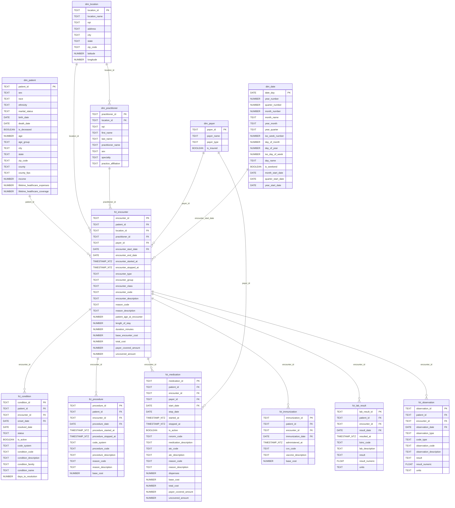

# Core mart data model (`SYNTHEA.MARTS`)

**Author:** Cortwright Grant

A star schema with five dimensions and seven facts, built on Tuva Core. `fct_encounter` is the hub. Each of the six clinical-event facts points at it through `encounter_id`, which is how an event reaches its facility, practitioner and payer.

Column names and types are as built in Snowflake. Definitions of each column are in [`_core__models.yml`](../synthea_analytics/models/marts/core/_core__models.yml) and in the dbt docs site (`dbtf docs serve`).

## Entity-relationship diagram

The diagram leaves out two sets of lines so it stays readable. Every clinical fact also has its own `patient_id` → `dim_patient` and its event date → `dim_date.date_day`, as the table below shows.

## Grain and join keys

| Table | One row per | Primary key | Joins to |
|---|---|---|---|
| `dim_patient` | patient, living or deceased | `patient_id` | — |
| `dim_location` | care facility (Synthea organization) | `location_id` | — |
| `dim_practitioner` | clinician | `practitioner_id` | `dim_location` |
| `dim_payer` | payer, including "No Insurance" | `payer_id` | — |
| `dim_date` | calendar day, 1915-01-01 to end of current year | `date_day` | — |
| `fct_encounter` | encounter | `encounter_id` | `dim_patient`, `dim_location`, `dim_practitioner`, `dim_payer`, `dim_date` on `encounter_start_date` |
| `fct_condition` | condition on a problem list (SNOMED CT) | `condition_id` | `fct_encounter`, `dim_patient`, `dim_date` on `onset_date` |
| `fct_procedure` | procedure performed (SNOMED CT) | `procedure_id` | `fct_encounter`, `dim_patient`, `dim_date` on `procedure_date` |
| `fct_medication` | medication order (RxNorm) | `medication_id` | `fct_encounter`, `dim_patient`, `dim_payer`, `dim_date` on `start_date` |
| `fct_immunization` | vaccine administered (CVX) | `immunization_id` | `fct_encounter`, `dim_patient`, `dim_date` on `immunization_date` |
| `fct_lab_result` | resulted lab analyte (LOINC) | `lab_result_id` | `fct_encounter`, `dim_patient`, `dim_date` on `result_date` |
| `fct_observation` | observation (vitals, surveys, social history) | `observation_id` | `fct_encounter`, `dim_patient`, `dim_date` on `observation_date` |

## Design notes

- **Natural keys.** Keys are Synthea's own UUIDs (or Tuva-generated IDs for conditions and procedures). There is one source system, so no surrogate keys are needed.
- **The encounter is the hub.** A clinical fact reaches its facility, practitioner and payer through `fct_encounter`, not through its own foreign keys. The exception is `fct_medication`, which carries `payer_id` because Synthea bills medications separately. It matches the encounter's payer on every row in this dataset.
- **Practitioner is effectively facility.** This Synthea build has exactly one practitioner per facility, all in general practice. The model allows many practitioners per facility, but analysis by practitioner is in practice analysis by facility.
- **Costs don't roll up.** `fct_encounter.total_cost` is Synthea's claim total. It is not the sum of the line-item costs in the procedure, medication and immunization facts, so use each as given and don't add them together.
- **Every relationship is tested.** Each primary key is tested unique and not null, and each foreign key in the diagram has a `relationships` test. Each fact also has an `equal_rowcount` test against the Tuva Core table it is built on, which proves no join dropped or duplicated a row.
